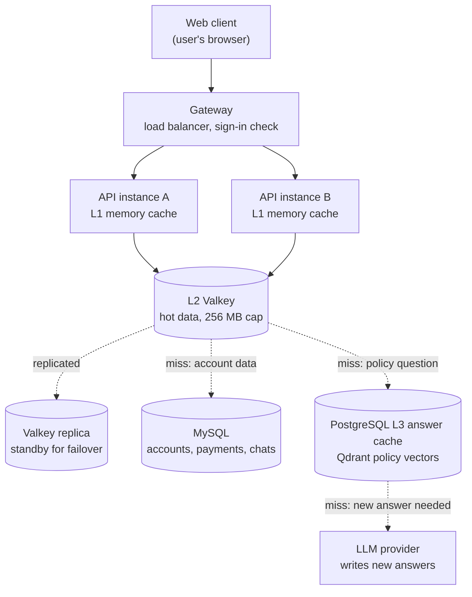
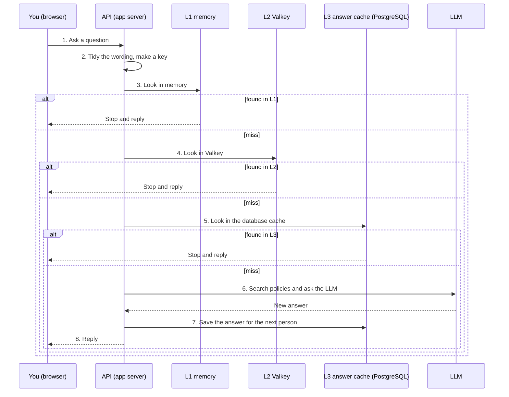
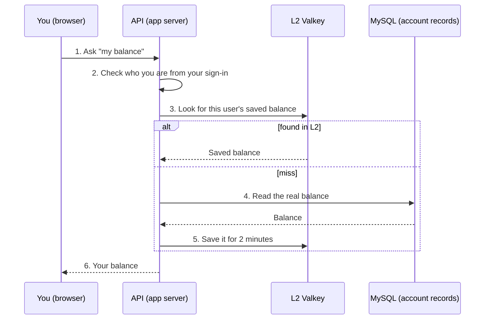
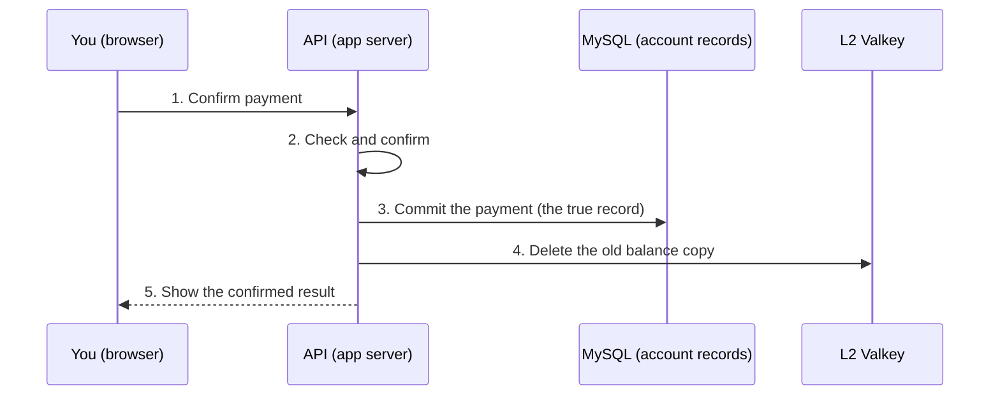
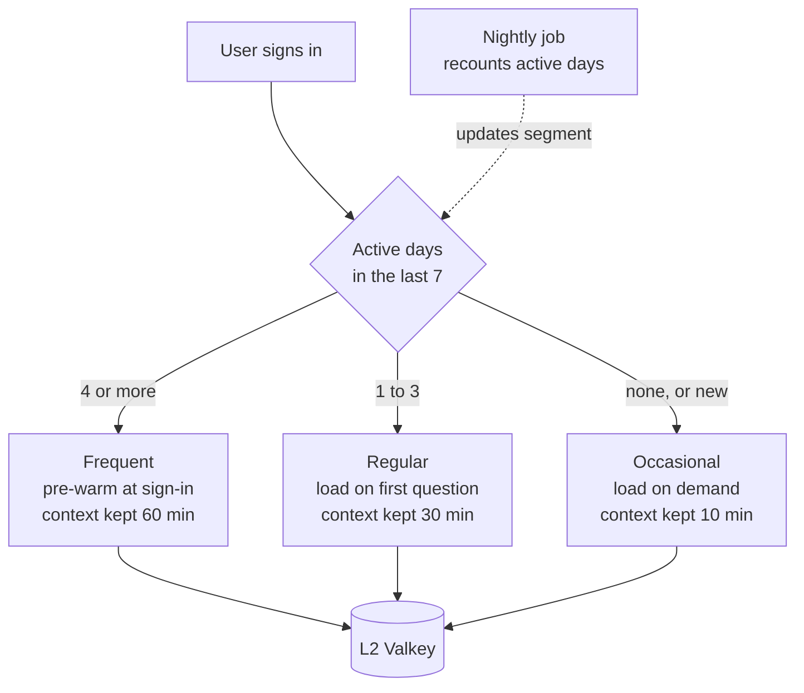

# Caching for 20 concurrent users: small, tiered, and not bound to RAM

**Design basis:** 90,000 registered users, 10,000 daily active users and about 20 concurrent users. The shared cache uses the Valkey server and the official `valkey-py` client.

Twenty simultaneous users do not need a large memory cache. They need a few hundred megabytes of bounded hot data, a durable cache on disk, and strict protection of the one scarce resource, the LLM provider. This is a revision of the earlier single-tier cache design.

| 90,000 | 10,000 | 20 | 4 |
|---|---|---|---|
| registered users | daily active users | concurrent users at peak | places to look before the LLM |

---

## The big picture

Registered users are who *could* visit. Daily active users are who visit in a day. Concurrent users are who are on at the same moment, and that last number, 20, is what the cache is sized for. Everything below is built for 20 people at once, drawing on a population of 90,000.

The cache sits between the API and the slower systems. Solid arrows are the normal path; dashed arrows are taken only when a cache has no saved copy. MySQL and PostgreSQL remain the records of truth; the LLM is called last.

> **Read it top to bottom.** Four places are checked in turn: memory inside the API (L1), Valkey (L2), the saved-answer table in PostgreSQL (L3), and finally the LLM.

---

## From 90,000 users down to 20 at once

The cache is sized by working back from the registered population to what actually touches it at the same moment.

| Step | Number | How we get there |
|---|---|---|
| Registered users | 90,000 | All accounts; most are idle on any given day |
| Daily active users | 10,000 | About 11% visit in a day |
| Busiest hour | about 1,000 sessions | Assumes 10% of daily users arrive in the peak hour |
| Live conversation contexts | about 500 | Sessions touched in the last 30 minutes |
| Concurrent users | 20 | People sending a message or waiting for a reply at the same moment |
| Requests per second | about 0.5 average, 2 at peak | One message per user every 40 s; busiest minute 4× average |
| Valkey operations per second | about 20 to 40 at peak | Roughly 10 to 20 cache operations per request |

The cache holds the roughly 500 live contexts, not 90,000 users. A single Valkey node handles well over 50,000 simple operations per second on ordinary hardware (measure yours with the `valkey-benchmark` tool), so peak load here is under 0.1% of its capacity.

---

## What changed, and why

The earlier note sized Valkey from daily active users: 10,000 users at 10 KB each is 100 MB of context that nobody is using at the same moment. Cache size follows the *working set*, not the registered or daily count. That mistake pushes you toward a bigger instance and makes RAM look like the constraint.

The revision does four things:

1. It shrinks Valkey to a hard-capped hot tier.
2. It adds an in-process tier that removes most network hops.
3. It moves the large, long-lived cache (generated answers) onto PostgreSQL disk.
4. It adds concurrency guards in front of the LLM, because that is where 20 users will actually queue.

> **Assumptions to measure.** Each user sends a message about every 40 s; the busiest minute is 4× average; a chat turn that reaches the LLM takes 2–6 s. That gives roughly 0.5 requests/s on average and 2/s at peak, with at most 20 requests in flight (Little's law: in-flight = rate × time in system).

---

## The workload, stated plainly

At 20 concurrent users the system is latency-bound, not throughput-bound. Memory is not close to the limit. The queues that form are, in order: the LLM rate limit and latency, the database connection pool, and the event loop if anything blocks. A cache earns its place by removing LLM calls and vector queries, not by saving bytes.

---

## Follow one question through the system

Each diagram below is a *swimlane*: every participant is one actor, and time runs from top to bottom. Where a cache has the saved copy, we stop and reply, and everything after it never runs.

> **Plain terms.** A *cache* is a saved copy of an answer, kept close so we do not rebuild it each time. L1, L2 and L3 only mean first, second and third place to look.

### A. A question anyone can ask

Example: "What does my plan say about dental cover?" The answer is the same for everyone, so it is safe to share.

1. The question arrives and the API tidies the wording, so small differences do not matter.
2. It looks in its own memory, then Valkey, then the saved-answer table. Most repeat questions end at one of these three.
3. Only if all three miss does it search the policies and ask the LLM, the slow and costly step (about 2 s).
4. The new answer is saved so the next person gets it without the LLM.

### B. A personal question

Example: "What is my balance?" This is private to one person, so the shared L1 and L3 are skipped.

1. The API first confirms who you are from your sign-in, never from anything typed in the question.
2. The saved balance belongs to your account only and lives two minutes at most.
3. If it is missing, the API reads the real balance from MySQL and saves a fresh copy.

### C. After a payment

The saved balance is thrown away the moment a payment is recorded, so nobody sees an old number.

1. The payment is recorded in MySQL first. That is the true record.
2. Only then is the saved balance deleted. The next balance question misses, reads MySQL, and gets the new figure.

---

## Why more than one layer? Use the balance as the example

One cache for everything would be simpler, but different data needs different rules. Public answers can be shared by everyone and kept for hours. A balance belongs to one person and must be right after a payment. Each layer exists because it suits one kind of data.

| Layer | Everyday picture | Good for | Used for a balance? |
|---|---|---|---|
| **L1** memory | A sticky note on your own desk | Fastest, but only one API instance sees it | **No.** Another instance could show an old balance after a payment. |
| **L2** Valkey | A shared whiteboard | Every instance reads it, and one delete fixes it for all | **Yes** |
| **L3** database | A filing cabinet | Large and lasting, for answers that are the same for everyone | **No.** A balance is personal and changes. |
| Origin | Asking the account office | Always correct, slowest | **Yes**, when Valkey has no copy |

### Asha asks: "Can you please check the balance?"

1. The API reads Asha's sign-in and learns she is user 4821. It never takes the user from her message.
2. It looks in Valkey for "balance of user 4821". The first time there is none, so it reads the true balance from MySQL (say ₹2,400 due), saves it in Valkey for 2 minutes, and replies.
3. Thirty seconds later she asks again. Valkey has it, so the reply is immediate and MySQL is not touched.
4. She pays. MySQL records the payment, then the saved balance is deleted. Her next question reads the new figure.

**Is this realistic?** Mostly yes, with one honest caveat. At 20 concurrent users, MySQL reads one balance row by its key in a few milliseconds, so this cache saves little time. Keep it if you want a safe, simple pattern for later, and skip it if measurement shows MySQL is idle. The expensive part of a chat turn is the LLM call, and a personal answer cannot be shared between users, so that step is not cached. The practical saving is to keep balance replies short and templated rather than generated from scratch.

---

## Four tiers, one request path

A request walks down the tiers and stops at the first hit. Each tier is smaller and faster than the one below it, and each has a hard bound that does not depend on user count.

**Typical lookup time per tier** (order-of-magnitude assumptions for same-region infrastructure; replace them with your own measurements):

| Step | Typical time |
|---|---|
| L1 in-process | about 20 µs |
| L2 Valkey | about 1 ms |
| L3 PostgreSQL answer cache | about 10 ms |
| Origin: Qdrant search | about 30 ms |
| Origin: LLM generation | about 2 s |

The gap between the last two rows is the point: one avoided LLM call is worth thousands of cache lookups.

| Tier | Bound | Holds | Lifetime |
|---|---|---|---|
| **L1** in-process, per API worker | 48 MB, counted in bytes, not entries | Public FAQ and policy answers, plan settings, topic lists | 30–60 s |
| **L2** Valkey, shared | 256 MB hard cap, least-used items evicted first | User-scoped balance, active conversation context, rate counters, short locks | 2 min to 30 min, with jitter |
| **L3** PostgreSQL answer cache | Disk; pruned by last hit | Generated public answers with source, prompt and model versions | Until the corpus version changes |
| **Origin** | Concurrency limits | Qdrant retrieval, LLM generation, MySQL | Not cached here |

> **Why L1 is safe.** Per-worker copies can disagree for up to one TTL. That is acceptable for public content and unacceptable for money, so the balance never lives in L1.

---

## Valkey, sized for what it actually holds

Valkey keeps only small, hot, short-lived values. The large item in the old estimate, 5,000 generated answers, moves to L3, where it costs disk instead of RAM and survives restarts.

| Item | Earlier estimate | Revised hot set |
|---|---|---|
| Conversation context | 100 MB | 5 MB |
| Generated answers | 40 MB | 4 MB |
| FAQ and policy | 15 MB | 5 MB |
| Sessions and counters | 20 MB | 1 MB |

Raw payload only. Revised basis: about 1,000 sessions in the busiest hour and a 30-minute context lifetime leave roughly 500 live contexts at 10 KB, plus the 1,000 most-requested FAQ entries and 500 hot answers.

That is about 15 MB of payload, perhaps 30 MB in memory after Valkey overhead. The hard cap of 256 MB gives roughly eight times headroom, and an eviction when it is exceeded costs one repeat lookup, not an outage. Provision a 512 MB instance so the cap, not the host, is the limit.

Valkey is a disposable copy, so persistence is switched off. Compress larger values, reject very large ones, and put a TTL with 10–20% jitter on every key so entries do not expire together. Anything that must not disappear, such as session revocation, stays in MySQL or a separate non-evicting store. An evicting cache is the wrong home for it.

---

## Frequent and occasional users

Not all 10,000 daily users behave alike. A small group visits almost every day and sends most of the traffic; a long tail visits once in a while. The cache treats them differently so memory goes where it pays off.

| | Frequent | Regular | Occasional |
|---|---|---|---|
| Who | Active 4 or more of the last 7 days | Active 1 to 3 days | No activity in 7 days, or new |
| Share of daily users (assumed) | about 10% (1,000) | about 30% (3,000) | about 60% (6,000) |
| Share of busiest-hour sessions (assumed) | about 500 | about 350 | about 150 |
| When their data is loaded | Pre-warmed at sign-in, in one pipelined call | On the first question | Only when needed |
| Conversation context kept | 60 min | 30 min | 10 min |
| Live contexts in the busiest hour | about 500 | about 175 | about 25 |
| First reply after a cold start | Fast: already loaded | A few ms slower | A few ms slower: rebuilt from MySQL |

**What this costs.** Live contexts equal sessions per hour times how long a context is kept. That gives about 700 live contexts, or roughly 7 MB, instead of 5 MB with one setting for everyone. The extra 2 MB buys faster first replies for the people who ask most often.

**How the segment is maintained**
1. MySQL keeps a small activity record per user: last active date and active days in the last 7. It is updated at most once per session, not per message.
2. A nightly job recounts and sets the segment. A user becomes Frequent at 4 or more active days and drops back only below 2, so nobody flips back and forth.
3. The segment is copied into the user's session entry in Valkey, so no extra lookup is needed.
4. Valkey's least-frequently-used eviction already favours keys that are read often, so frequent users' data stays resident under pressure and occasional users' data is dropped first. The segment adds the longer or shorter lifetimes on top.

**What the segment must never change**
- **Correctness.** The balance keeps its 1 to 2 minute lifetime for everyone. A frequent user does not get an older balance.
- **Security and limits.** Identity, authorization and rate limits are the same for every segment. The segment is only a hint about how long to keep data.
- **Fairness.** Cap each user at about 2 simultaneous LLM calls within the global limit of 8, so one heavy user cannot starve the other 19.
- **Failure.** If the segment is missing or cannot be read, treat the user as Regular.

> The thresholds (4 days, 60, 30 and 10 minutes) and the traffic shares are starting assumptions. Set them from the activity record after a few weeks of real use.

---

## Why Valkey will not be the bottleneck

Raw volume is not the risk. Valkey runs commands one at a time on its main thread, so the real ways it becomes a bottleneck are specific, and each has a simple rule.

| What could slow it down | Rule that prevents it |
|---|---|
| One slow command blocks every other request | Never use KEYS or full scans; delete with UNLINK; expire old data by versioned keys; alert on any slowlog entry over 10 ms |
| Large values | Cap values at 64 KB and compress anything larger |
| Many round trips per request | Pipeline the lookups for one request (balance, context, counter) into a single round trip |
| Connection churn | Persistent pool of about 20 connections per API worker; never connect per request |
| One very hot key | Not expected at 20 users; if it appears, copy public content into L1 for 30 s |
| Memory full | Hard 256 MB cap with least-frequently-used eviction; an eviction costs one repeat lookup |
| Disk snapshots pausing the server | Persistence off; the cache is disposable and is rebuilt from MySQL and PostgreSQL |
| Distance | Run in the same region and zone as the API so a lookup stays near 1 ms |
| Node failure | One primary plus one replica in a second zone, with automatic failover; the API fails open |

**Topology.** Use one primary and one replica. Do not use a cluster: sharding adds routing rules and multi-key limits, and it is justified only when data exceeds one node's memory or traffic exceeds one node's throughput. Neither is close here. The replica is for availability, not for read scaling. Balance reads always go to the primary, because a replica can lag behind a payment.

**Headroom as the user count grows.** Scaling is assumed to be linear from the 20-user case, with memory in the node at about twice the payload.

| Concurrent users | Valkey ops/s at peak | Live payload | Node memory needed | Action |
|---|---|---|---|---|
| 20 | 20 to 40 | about 15 MB | about 30 MB | Current design, 256 MB cap |
| 200 | 200 to 400 | about 150 MB | about 300 MB | Raise the cap to 1 GB, same single node |
| 2,000 | 2,000 to 4,000 | about 1.5 GB | about 3 GB | Larger node of 4 to 8 GB |
| 20,000 | 20,000 to 40,000 | about 15 GB | about 30 GB | Measure, then plan sharding |

**Scale up when** sustained operations exceed 30% of the measured benchmark, p99 latency stays above 5 ms, slowlog entries appear, or evictions climb while the hit ratio falls.

---

## Durable answer cache in PostgreSQL

Generated answers are expensive to make and cheap to store, so keep them in the database you already run. A unique index on a versioned key gives exact-match hits in a few milliseconds. The working memory this uses is the ordinary page cache, which the operating system manages and which degrades gracefully.

Pre-compute answers for the top FAQ questions when the corpus is indexed, so a re-index warms the cache before users arrive. Semantic matching with an embedding column and an HNSW index can lift the hit rate on rephrased questions. Treat it as an optional second step: use a strict similarity threshold, restrict it to public scope, and audit a sample of hits, because a near-miss returns the wrong policy answer with full confidence.

> **Never in L3.** Anything personal or time-sensitive. Account facts always come from an authorized read, optionally through the short-lived user-scoped L2 key.

---

## Single-flight, inside the process first

With two API instances, most duplicate work is between requests in the *same* process. An in-process future map collapses those without a network call. A Valkey lock is needed only across instances, and it should be a short lease that fails open: if it is not acquired within about two seconds, compute anyway, bounded by the concurrency limit below.

---

## Protect the scarce resource

Memory will not be the limit at this scale; the LLM provider will. Put three guards in front of the LLM, and measure them as carefully as the cache.

- **Concurrency cap.** A limit of about 8 simultaneous generation calls, with a queue timeout. Twenty users cannot send twenty simultaneous requests to a rate-limited API.
- **Rate budget.** A token bucket sized below the provider's requests-per-minute and tokens-per-minute limits, shared through Valkey counters, with a graceful "busy, try again" response when it is empty.
- **Stale on error.** If generation fails or is rate-limited, serve an expired public answer from L3 and mark it as possibly out of date. Never do this for account data.

---

## What lives where

| Data | L1 | L2 | L3 / source | Freshness rule |
|---|---|---|---|---|
| Public FAQ and policy answer | Yes, 60 s | Yes, 6–24 h | L3, versioned | New corpus version replaces keys |
| Plan settings, topic lists | Yes, 60 s | Optional | PostgreSQL | Short TTL |
| Account balance | **Never** | Yes, 1–2 min, user-scoped | MySQL | Delete after committed payment |
| Conversation context | No | Yes, 10 to 60 min by segment, bounded | MySQL | Rebuild from stored messages |
| Activity segment | No | Yes, with the session | MySQL | Recounted nightly; a hint only |
| Session revocation | **Never** | **Never** | MySQL | Must be immediate |
| Rate counters, locks | No | Yes, seconds | None | Loss is harmless |

---

## When Valkey or memory misbehaves

| Event | Behaviour |
|---|---|
| Valkey down or slow | 150 ms timeout, breaker opens after repeated failures, requests use L1, L3 and origin. Latency rises; correctness does not change. |
| Memory reaches the cap | LFU evicts the least-used keys. Hit ratio dips, nothing breaks. Alert on a sustained eviction rate, not on high usage. |
| Deploy or restart | L1 is empty and L2 may be. Warm the top FAQ entries from L3 at startup. |
| LLM rate-limited | Queue briefly, then serve stale public answers or a busy message. Account answers are never served stale. |
| Corpus re-index | Bump the corpus version. Old keys become unreachable and expire; no scan-and-delete. |

---

## How to tell whether RAM is ever the problem

Memory is the bottleneck only if three things happen together: Valkey memory used sits at its cap, evictions climb steadily, and the L2 hit ratio falls. Any one alone is normal. Run the ramp 20, 40, 60, 100 users with a realistic mix of repeated and unique questions, cold and warm, and watch these in order:

1. LLM 429 rate and p95 generation latency.
2. Database pool wait time and active connections against the total budget.
3. Event-loop lag and API p95 and p99.
4. Per-tier hit ratio, and LLM and vector calls per request.
5. Valkey memory used, evictions and operation latency.

Cap the Valkey pool near 20 connections per worker and size the database pool from the total connection budget across workers, not from the user count.

---

## Build order

1. Instrument the current path: LLM calls, vector calls, pool waits, latency percentiles.
2. Add the LLM concurrency limit and rate budget. This is usually the largest win and needs no cache.
3. Add the answer cache in PostgreSQL (L3) and warm it from the FAQ list.
4. Add capped Valkey (L2) for the user-scoped balance, active context, rate counters and locks, with post-payment invalidation, pipelined lookups and fail-open timeouts.
5. Add the activity record and segments (frequent, regular, occasional) once real usage data can set the thresholds.
6. Add L1 and the in-process single-flight only if load tests show Valkey lookups are a measurable delay.
7. Consider semantic matching only after the exact-match hit rate is measured.

---

*Figures are planning assumptions derived from the stated 20 concurrent users, 10,000 daily active users and 90,000 registered users. Latencies, hit ratios and the revised memory estimate must be validated against measured traffic before production. MySQL and PostgreSQL remain the systems of record; every cache tier is disposable.*
